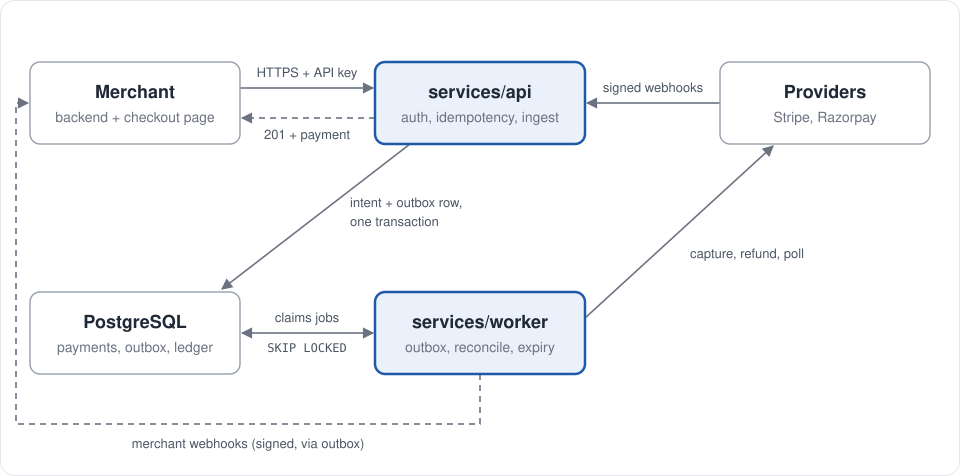
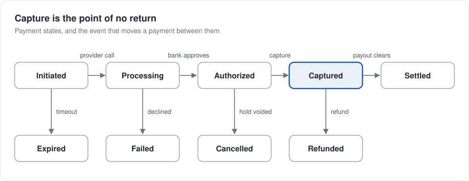

# payment_orchestrator

A payment orchestration layer written in Rust. It sits between merchants and payment
service providers, owns the lifecycle of every payment, and keeps a double-entry ledger
of the money that moves.

> **Status: early.** The workspace layout, the schema design and the database connection
> layer exist. The HTTP API, the domain state machine, the provider adapters and the
> ledger are not implemented yet, and the initial migration does not apply as written.
> See [Project status](#project-status) for exactly what works today.

## What it is

The orchestrator is **not** a payment processor. It never touches card data and never
moves money itself — Stripe and Razorpay do that. What it owns is the *intent and its
history*: which providers were tried, what each replied, how much is authorized versus
captured versus refunded, and what each merchant is owed.

A provider knows about its own transaction. Only the orchestrator knows the whole story.

That split buys three things:

- **One merchant-facing API, many providers behind it.** Adding a provider does not
  change how a merchant integrates.
- **Routing and failover.** A charge that fails at one provider can be retried at
  another, under the same payment.
- **An independent record.** When a provider's dashboard and your books disagree, the
  ledger is what answers to the merchant.

## Architecture

<p align="center">
  
</p>

Two deployable services share one Postgres database. **`services/api`** is thin and
fast: it authenticates, deduplicates, records intent and returns. **`services/worker`**
does everything that involves waiting on someone else: provider calls, webhook
processing, retries, expiry and reconciliation. The API never calls a provider directly
— it leaves a row in the outbox, and the worker picks it up.

## The model

Two ideas carry the design.

**A payment is the intent; an attempt is one try at one provider.** One payment
(`payments.id`) has many rows in `payment_attempts`. A decline at Stripe does not fail the
payment — it opens a new attempt at Razorpay. To the merchant it is still one payment
that eventually succeeded.

**Your database and a provider cannot be in one transaction.** There is no atomic
"charge the card and update the row". The system is instead eventually consistent and
self-correcting: write the intent before the call, treat webhooks as unreliable, and run
a reconciler that compares your state against the provider's until they agree.

Money moves in three steps, not one — authorize (a hold), capture (claiming it), settle
(it lands) — which is why `payments` carries `authorized_amount`, `captured_amount` and
`refunded_amount` separately, with the invariant
`0 <= captured <= authorized <= amount` and `0 <= refunded <= captured`.

## Payment lifecycle

<p align="center">
  
</p>

The top row is the happy path; the bottom row holds the exits. Before capture, a payment
can still be walked back for free by voiding the hold. After capture, the only way back
is a refund, which costs the processing fee and shows on the cardholder's statement.

The create endpoint only ever writes `initiated`. Every later transition is made by the
worker, in response to a provider call or webhook, and only forward along these arrows —
so a duplicate or out-of-order webhook can never move a payment backwards.

## Repository layout

```
crates/
  domain/        payment states, legal transitions, money invariants (pure, no I/O)
  application/   use cases: create, authorize, capture, refund, route
  providers/     Stripe and Razorpay adapters behind one trait
  persistence/   repositories, migrations, connection pool
  ledger/        double-entry posting, append-only
  common/        shared types and errors
services/
  api/           HTTP edge: auth, idempotency, DTOs
  worker/        webhooks, retries, timeouts, reconciliation
apps/            Next.js dashboard
```

Dependencies point inward. `domain` depends on nothing — no `sqlx`, no `axum`, no
provider SDK — so the state machine is testable without a database running.

## Getting started

### Prerequisites

- Rust 1.94 or later (the workspace uses edition 2024)
- PostgreSQL 14 or later, local or managed
- [`sqlx-cli`](https://crates.io/crates/sqlx-cli) for migrations:
  ```bash
  cargo install sqlx-cli --no-default-features --features rustls,postgres
  ```
- Node.js 20+ and npm, only if you want to run the dashboard in `apps/`

### Configuration

Copy the example file and fill in your connection string:

```bash
cp .env.example .env
```

| variable | required | description |
| --- | --- | --- |
| `DATABASE_URL` | yes | PostgreSQL connection string. Managed providers generally need `?sslmode=require`. |

`.env` is gitignored. Never commit real credentials.

### Database

```bash
sqlx database create
sqlx migrate run --source crates/persistence/migrations
```

> The migration in `crates/persistence/migrations/001_create_payments.sql` is currently a
> design sketch rather than valid SQL and will fail. Fixing it is the first task in the
> roadmap below.

### Run

```bash
cargo run -p api      # connects to the database and reports the pool
cargo run -p worker   # placeholder
```

The API does not serve HTTP yet — see [Project status](#project-status).

### Dashboard

```bash
cd apps
npm install
npm run dev
```

## Development

```bash
cargo build --workspace
cargo test --workspace
cargo clippy --workspace --all-targets
cargo fmt --all
```

Workspace lints are set in the root `Cargo.toml`: `unsafe_code` is forbidden,
`unused_must_use` is denied, and `todo!`, `dbg!` and `.unwrap()` are flagged. Keep
`cargo clippy` clean before opening a pull request.

## Project status

| component | state |
| --- | --- |
| `persistence` | Connection pool and health ping. Working. |
| `domain` | Not started — still a generated `main.rs`. |
| `application` | Not started. |
| `providers` | Not started. |
| `ledger` | Not started. |
| `common` | Not started, and its role is undecided. |
| `services/api` | Connects to the database and prints the result. No router yet, despite the `axum` dependency. |
| `services/worker` | Not started. |
| migration | Written, does not apply. |

Every crate except the two under `services/` is meant to be a library, but they are
currently binaries (`src/main.rs`), so nothing can import them. The build says so and
continues:

```
warning: persistence v0.1.0 ignoring invalid dependency `domain`
         which is missing a lib target
```

## Roadmap

1. Convert the library crates from `main.rs` to `lib.rs` so the dependency graph is real.
2. Rewrite `001_create_payments.sql` as valid SQL — enums before tables, `TIMESTAMPTZ`
   rather than `TIMESTAMP`, and a table name that is not a reserved word.
3. Encode the payment state machine and the money invariants in `domain`.
4. Add idempotency keys with a unique constraint on `(merchant_id, idemp_key)`.
5. Build the first real endpoints in `services/api` on top of that.
6. Add a provider trait and one adapter.
7. Add webhook ingestion with signature verification and event deduplication.
8. Add the reconciler to `services/worker`.

## License

MIT. See the `license` field in `Cargo.toml`.
